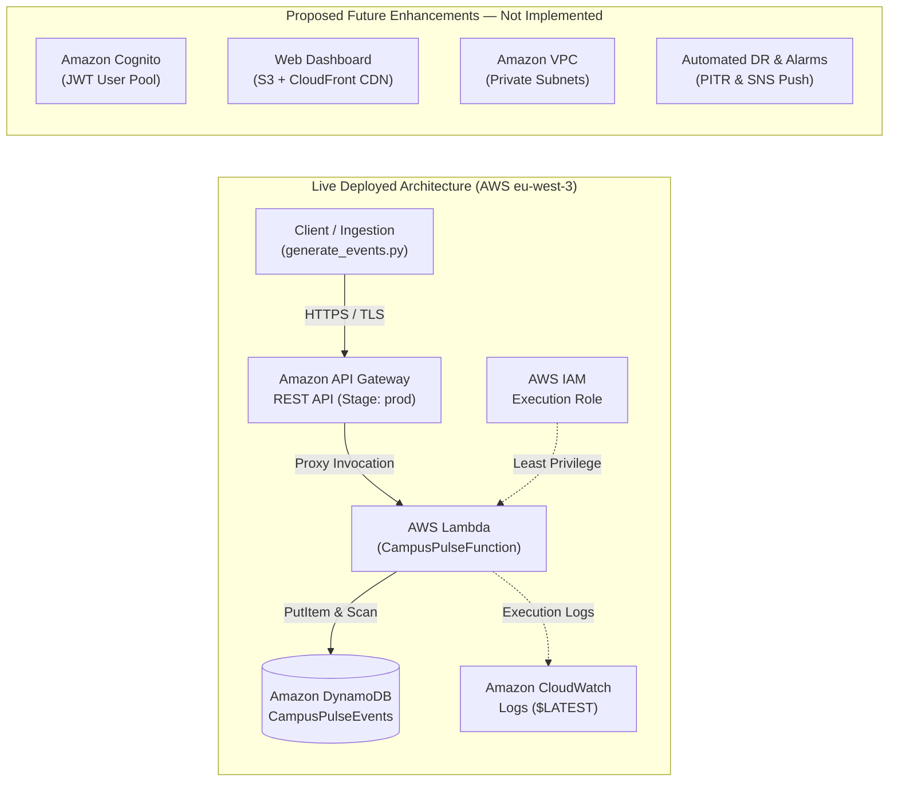

# CampusPulse 2026
## Cloud-Native Smart Campus Operations Platform

**Module:** Big Data & Cloud Computing  
**Cloud provider:** Amazon Web Services (AWS)  
**Region:** Paris (`eu-west-3`)  
**Team:** Joswikkha Dilli Babu, Preethi Krishnamoorthi, Anbuselvan Ponnusamy

---

# Slide 1 — Introduction
- Smart campuses generate readings such as occupancy, energy consumption and temperature.
- CampusPulse demonstrates how these readings can be collected and monitored using cloud services.
- The prototype processes simulated campus events through a REST API.

**Speaker notes:** Introduce the problem and explain that this is a working cloud prototype.

---

# Slide 2 — Objectives
- Receive simulated campus readings.
- Validate and process incoming events.
- Store event records in a cloud database.
- Calculate operational statistics.
- Identify abnormal readings through alerts.
- Observe application execution using cloud logs.

**Speaker notes:** Explain that the project demonstrates the main components of a small cloud-native monitoring platform.

---

# Slide 3 — Architecture: Live Deployed System vs Future Scope (2:00 - 3:30)
- **Live Ingestion**: `generate_events.py` & PowerShell/cURL send TLS HTTPS requests.
- **API Gateway**: REST API (stage `prod`, regional `eu-west-3`) exposes `/health`, `/login`, `/events`, `/stats`, `/alerts`.
- **AWS Lambda**: `CampusPulseFunction` (Python 3.12, 256MB) validates input, runs threshold checks, and calculates campus statistics.
- **Amazon DynamoDB**: `CampusPulseEvents` table (Pay-per-request / on-demand) persists telemetry.
- **Cross-Cutting**: AWS IAM least-privilege execution role; Amazon CloudWatch captures live execution logs.

**Architecture Diagram File:** [`submission/architecture_diagram.svg`](file:///d:/CampusPulse2026_starter/submission/architecture_diagram.svg)  
*(Also rendered natively on Slide 3 of `CampusPulse2026_Presentation.pptx`)*

**Speaker notes (1.5 min):**
Walk through the live request path: API Gateway receives requests, Lambda processes business logic and aggregates room occupancy, and DynamoDB stores events on-demand. CloudWatch collects execution logs, and IAM enforces least privilege. Highlight the clear visual demarcation: the lower section explicitly shows 'Proposed Future Enhancements — Not Implemented' (Cognito, S3/CloudFront dashboard, VPC, and automated backups). We take pride in reporting only what is actually deployed.

---

# Slide 4 — Implementation
- Implemented using Python and AWS Lambda.
- Exposed REST endpoints for health checks, login, event submission, retrieval, statistics and alerts.
- Stored events in the `CampusPulseEvents` DynamoDB table.
- Used a Python script to generate simulated campus events.
- Deployed in AWS region `eu-west-3`.

**Speaker notes:** Mention that the application is deployed and was tested against the live API.

---

# Slide 5 — Security
- Demo login distinguishes operator and admin roles.
- Protected endpoints require bearer-token authentication.
- IAM permissions control Lambda access to AWS services.
- CloudWatch logs support troubleshooting.
- The demo authentication is not intended for production use.

**Speaker notes:** Acknowledge the prototype's security limitations and explain what would be needed for production.

---

# Slide 6 — Testing and Results (5:30 - 7:00)
- Six automated unit tests passed in 0.001s (`Ran 6 tests ... OK`).
- Four live simulated event submissions returned HTTP `201 Created`.
- Five total events stored in DynamoDB (1 pre-existing baseline + 4 newly ingested).
- Statistics endpoint returned: 5 total events, 1 energy reading (18.5 kWh), 3 alerts.
- **Occupancy Metric Verified**: Total latest occupancy = 180 people.
  - Calculated as latest reading per distinct room:
  - Library-A A203 (latest: 95) + Building A Room 101 (latest: 85) = **180 people total**.
- Alerts endpoint verified: 3 abnormal readings returned (Occ: 95, Temp: 38°C, baseline Occ: 85).
- CloudWatch Lambda logs inspected and verified live.

**Speaker notes (1.5 min):** Show the saved evidence screenshots for unit tests, events, statistics, alerts and CloudWatch. Proactively explain the 180 occupancy figure: the backend aggregation sums the latest reading across distinct rooms (95 in Room A203 + 85 in Room 101 = 180), proving end-to-end data integrity.

---

# Slide 7 — Cost and Scalability
- Serverless compute avoids managing continuously running application servers.
- DynamoDB on-demand capacity suits a small demonstration workload.
- An AWS budget alert was configured.
- Actual costs must be checked in AWS Billing.
- Higher traffic would require additional load testing and performance evaluation.

**Speaker notes:** Explain the cost-conscious choices without claiming the application is free or production-ready.

---

# Slide 8 — Limitations and Future Work
- Demo authentication rather than a production identity provider.
- No custom VPC or automated backups.
- No complete disaster-recovery implementation.
- Future work could include a dashboard, stronger identity management, automated backups and more extensive monitoring.

**Speaker notes:** Clearly distinguish implemented functionality from future improvements.

---

# Slide 9 — Conclusion and Demo
- CampusPulse demonstrates a deployed serverless campus-event pipeline.
- The application receives, stores and retrieves simulated events.
- Statistics and abnormal readings can be queried through the API.
- Automated tests and CloudWatch logs provide validation evidence.

**Live demo plan:**
1. Call `/health`.
2. Show event records.
3. Show `/stats`.
4. Show `/alerts`.
5. Briefly show unit tests and CloudWatch logs.

**Closing:** CampusPulse demonstrates how AWS serverless services can be combined to build a small, observable and cost-conscious cloud application.